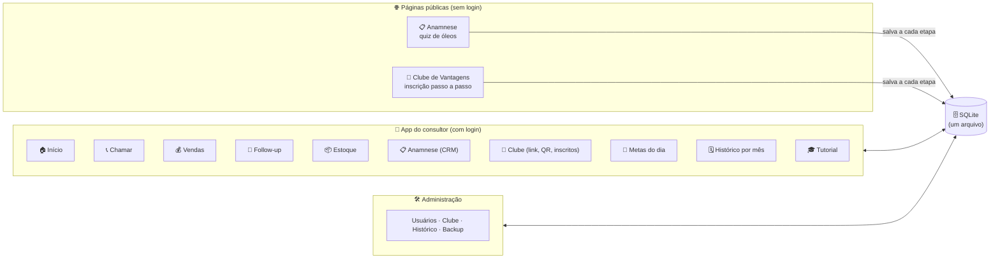
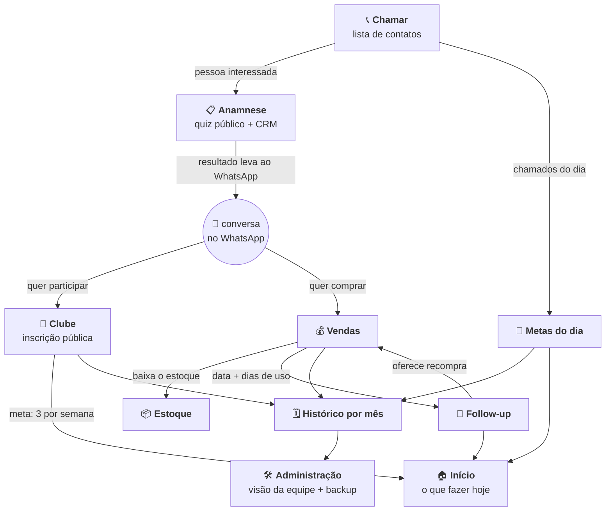
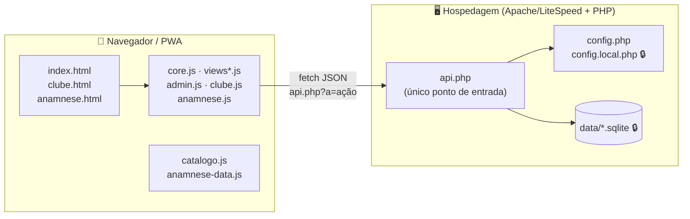
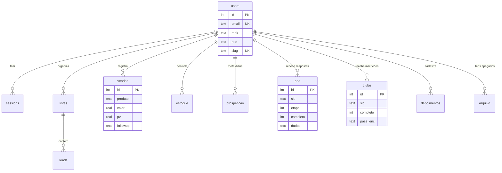

# 💎 Diamante App

> Um painel diário, simples e mobile-first, para consultores de bem-estar que constroem equipe e fidelizam clientes com óleos essenciais.

**Stack:** PHP 8.3 · SQLite · JavaScript puro (sem framework e sem build) · PWA · Hospedagem compartilhada (Hostinger)

> ℹ️ Projeto independente, criado por um consultor para a própria rotina. **Não é um produto oficial da doTERRA** e não tem vínculo com a empresa. "doTERRA" é marca de seus respectivos titulares.

---

## Sumário

1. [Por que este projeto existe](#1-por-que-este-projeto-existe)
2. [Visão geral em uma imagem](#2-visão-geral-em-uma-imagem)
3. [Funcionalidades e o porquê de cada uma](#3-funcionalidades-e-o-porquê-de-cada-uma)
4. [Como as funcionalidades se conectam](#4-como-as-funcionalidades-se-conectam)
5. [Arquitetura](#5-arquitetura)
6. [Modelo de dados](#6-modelo-de-dados)
7. [Segurança e privacidade (LGPD)](#7-segurança-e-privacidade-lgpd)
8. [Estrutura de pastas](#8-estrutura-de-pastas)
9. [Rodando no seu computador](#9-rodando-no-seu-computador)
10. [Publicando na Hostinger e atualizando sem perder dados](#10-publicando-na-hostinger-e-atualizando-sem-perder-dados)
11. [Backup](#11-backup)
12. [Versão portfólio (pública) × versão privada](#12-versão-portfólio-pública--versão-privada)
13. [Decisões de projeto](#13-decisões-de-projeto)
14. [Próximos passos](#14-próximos-passos)
15. [Licença e autoria](#15-licença-e-autoria)

---

## 1. Por que este projeto existe

Em uma equipe de vendas diretas, o resultado não depende de ideias complicadas. Ele depende de **fazer poucas coisas todos os dias**: chamar pessoas novas, acompanhar quem já comprou, trazer gente para o programa de fidelidade e formar líderes.

O problema é que isso costuma ficar espalhado em planilhas, no WhatsApp e na memória. O consultor esquece quem precisava de retorno, perde o fio de quem respondeu ao quiz e não sabe se está avançando.

O Diamante App junta tudo em **um único lugar, que cabe no celular**, e responde todo dia a uma pergunta: **"O que eu preciso fazer hoje?"**

Os princípios que guiam o projeto:

| Princípio | O que significa na prática |
|---|---|
| **Poucas ações, todo dia** | A tela inicial mostra só o que importa hoje, não um painel cheio de números. |
| **Dado que dura para sempre** | Nada é apagado de verdade. O que o usuário "apaga" vai para um arquivo permanente. |
| **Qualquer um consegue usar** | Interface em português, uma pergunta por tela, botões grandes, funciona no celular. |
| **Barato e simples de manter** | Roda em hospedagem compartilhada comum, sem servidor próprio, sem Node, sem build. |
| **Privacidade desde o desenho** | Dados de saúde e de cadastro ficam protegidos e o consentimento é pedido antes de tudo. |

---

## 2. Visão geral em uma imagem



Existem **três "portas de entrada"**:

- **Público** (`anamnese.html`, `clube.html`): quem responde ao quiz ou se inscreve no Clube. Não precisa de conta. O link é do consultor, então tudo o que a pessoa preenche cai direto na lista dele.
- **Consultor** (`index.html`): o painel de trabalho do dia a dia.
- **Administrador** (aba dentro do mesmo app): vê a produção de todos, a senha dos inscritos do Clube e faz backups.

---

## 3. Funcionalidades e o porquê de cada uma

### 🏠 Início: "o que eu faço hoje?"
**O quê:** mostra o rank atual do consultor ao lado do próximo rank, um botão para conferir a meta oficial no escritório virtual e uma lista curta de tarefas do dia (contatos a chamar, meta semanal do Clube, follow-ups pendentes e, nos primeiros 7 dias, o Tutorial).

**Por quê:** quem começa se perde em muitas telas. A home reduz tudo a poucos cartões clicáveis. Ela **não mostra meta de PV** de propósito: o acompanhamento oficial acontece no escritório virtual da empresa, e duplicar números no app geraria divergência e desconfiança.

### 📞 Chamar: lista de contatos e abordagem
**O quê:** o consultor importa contatos (arquivo `.vcf` ou `.csv`, ou direto da agenda do celular quando o navegador permite), organiza em listas e chama um por um. Cada contato recebe um status (novo, chamado, respondeu, interessado, virou cliente ou sem interesse), pode ser pulado e abre a conversa no WhatsApp com uma mensagem pronta.

**Por quê:** a prospecção morre quando fica "para depois". Mostrar **um contato por vez** tira a decisão da frente e transforma a tarefa em uma fila simples. A quantidade diária sugerida **sobe com o rank** (Consultor 3, Manager 4, e assim por diante): quem lidera mais, faz mais.

### 🎯 Metas do dia
**O quê:** registra quantas pessoas foram chamadas, quantas ficaram interessadas e quantas compraram, com a meta diária do rank.

**Por quê:** é o termômetro do hábito. O que se mede todo dia vira rotina, e o histórico mostra a evolução.

### 📋 Anamnese: o quiz que vira conversa
**O quê:** uma página **pública** com um quiz de 32 telas (uma pergunta por tela, em 6 etapas) sobre objetivos e rotina. No final, o motor de recomendação monta um **kit inicial** e um **protocolo** de óleos, adaptado ao perfil. O resultado inclui avisos de segurança (gestantes, lactantes, crianças pequenas, epilepsia, hipertensão) e um botão que leva a pessoa direto ao **WhatsApp do consultor**. Dentro do app, cada resposta vira um cartão de CRM: respostas, kit, protocolo e pontos de atenção.

**Por quê:**
- Vender sem entender a pessoa gera recompra baixa. A anamnese é uma **abordagem consultiva**: a pessoa sente que foi ouvida e o consultor já chega na conversa sabendo o que ela precisa.
- Cada resposta é **salva na hora**, mesmo que a pessoa desista no meio, para o consultor poder retomar o contato com quem parou na pergunta 14.
- O **consentimento é a primeira pergunta**. Sem ele, nada é gravado (importante porque envolve dados de saúde).
- Os avisos de segurança existem porque recomendar óleo sem considerar gestação ou epilepsia seria irresponsável.

### 💎 Clube de Vantagens
**O quê:** o consultor gera um **link e um QR Code** próprios. A pessoa abre uma página pública e faz a inscrição em etapas (nome, contato, endereço com busca automática por CEP, senha, consentimento). A tela mostra os benefícios do clube, e o app acompanha uma **meta de 3 pessoas por semana**. O administrador consegue consultar a senha que a pessoa definiu.

**Por quê:** fidelizar é o que sustenta a equipe. O Clube é o ponto de entrada para quem vai comprar todo mês. Dividir a inscrição em **uma pergunta por tela** reduz o abandono (formulário longo no celular afasta gente) e, como cada etapa é salva, o consultor vê **quem parou e em qual passo**, e pode ajudar. A meta semanal de 3 transforma "trazer gente" em hábito pequeno e alcançável.

> A senha fica **cifrada** no banco e só o administrador consegue revelá-la (veja [Segurança](#7-segurança-e-privacidade-lgpd)). Isso existe porque, em alguns casos, o consultor precisa ajudar a pessoa a concluir o cadastro no sistema da empresa.

### 💰 Vendas
**O quê:** registra cada venda com cliente, produto (buscado em um catálogo local com preço e PV), quantidade, valor, data e **em quantos dias o cliente deve acabar o produto**. Pode abater automaticamente do estoque.

**Por quê:** sem registrar a venda não existe recompra. O campo "em quantos dias acaba" é a semente do follow-up: um frasco de 15 ml dura mais ou menos tempo conforme o uso, e o app usa essa estimativa para lembrar o consultor na hora certa.

### 🔔 Follow-up
**O quê:** lista quem deve ser procurado hoje (a data é calculada a partir da venda). Permite concluir, adiar ou oferecer uma nova compra pelo WhatsApp.

**Por quê:** o dinheiro da venda direta está na **recompra e na relação**. O follow-up automático faz o consultor falar com o cliente **no momento em que o produto está acabando**, que é quando a conversa é mais natural e a venda mais fácil.

### 📦 Estoque
**O quê:** controle simples do que o consultor tem em mãos, com um mínimo por produto. Ao registrar uma venda, o estoque baixa sozinho.

**Por quê:** evita prometer uma entrega e não ter o produto, e avisa quando algo está acabando.

### 🗓️ Histórico por mês
**O quê:** fecha cada mês com o resumo (contatos chamados, interessados, vendas, valor, PV) e permite baixar uma planilha.

**Por quê:** para liderar equipe é preciso **comparar meses**. Como nada é apagado, o histórico é confiável, e a planilha deixa o consultor guardar uma cópia só dele.

### 🎓 Tutorial
**O quê:** uma aula em vídeo (YouTube) dentro do app. Nos primeiros 7 dias após o cadastro, a home mostra um atalho sugerindo assistir; depois ela some, mas o item continua no menu.

**Por quê:** quem não entende o app nos primeiros dias, abandona. Um atalho no momento certo (e só nele) aumenta a adoção sem poluir a tela de quem já está acostumado.

### 👤 Minha conta
Perfil, WhatsApp (usado nas mensagens e no botão do quiz), rank atual e troca de senha. O rank define a meta diária de contatos e a comparação da home.

### 🛠️ Administração
**O quê:** lista de usuários, produção de cada um, histórico geral por mês, inscritos do Clube (com a senha, só para o administrador), planilhas e **backup**.

**Por quê:** quem forma líderes precisa **enxergar a equipe** sem perguntar um por um, e precisa ter a garantia de que os dados não se perdem.

---

## 4. Como as funcionalidades se conectam

O app foi pensado como um **funil de relacionamento**. Cada módulo alimenta o próximo, e o administrador enxerga o conjunto.



**Em palavras:**

1. **Chamar → Anamnese.** O consultor chama um contato e envia o link do quiz. A pessoa responde sozinha, no tempo dela.
2. **Anamnese → WhatsApp.** O resultado termina em um botão para conversar com o consultor, que já sabe o perfil dela.
3. **WhatsApp → Clube ou Venda.** Dependendo da conversa, a pessoa se inscreve no Clube (link e QR do consultor) ou compra.
4. **Venda → Estoque e Follow-up.** Registrar a venda baixa o estoque e agenda o retorno para quando o produto estiver acabando.
5. **Follow-up → Venda.** O retorno gera a recompra, e o ciclo recomeça.
6. **Tudo → Início e Histórico.** O que foi feito no dia alimenta as metas e o fechamento do mês.
7. **Tudo → Administração.** O administrador vê a produção de todos e mantém o backup.

**Peça central: o link do consultor.** O quiz e o Clube são identificados por um código (`?c=...`) que pertence a um consultor. É ele que garante que **toda resposta chegue ao consultor certo**, sem a pessoa precisar criar conta.

---

## 5. Arquitetura



**Escolhas e motivos:**

- **Um único `api.php`.** Todas as ações (`?a=login`, `?a=venda_add`, `?a=ana_salvar`...) passam por um roteador só. Fica fácil de auditar a segurança, porque há **um único lugar** onde entram sessão, proteção contra abuso e validação.
- **SQLite em vez de MySQL.** O banco é **um arquivo**. Isso torna o backup trivial (copiar o arquivo), elimina a configuração de banco e basta para o volume de uma equipe.
- **JavaScript puro, sem framework e sem build.** Quem mantém o projeto não precisa de Node, bundler nem deploy complicado: edita o arquivo, envia, funciona. Também deixa o app leve no celular.
- **Telas como funções.** Cada tela é uma função registrada (`D.V.vendas`, `D.V.clube`...) e cada botão é uma ação nomeada (`D.act['venda-new']`). Sem `onclick` no HTML, o que permite uma política de segurança (CSP) rígida.
- **PWA.** Pode ser instalado na tela inicial do celular e se comporta como app.
- **Fontes e bibliotecas hospedadas no próprio site** (Inter em `assets/fonts`, QR Code em `qrcode.js`). Não depende de CDN de terceiros, o que ajuda na privacidade e na CSP.
- **Catálogo local** (`catalogo.js`): a busca de produto é instantânea e funciona sem consultar o servidor.

### Papel de cada arquivo

| Arquivo | Responsabilidade |
|---|---|
| `index.html` + `boot.js` | Casca do app e ponto de partida. |
| `core.js` | Núcleo: utilidades, chamadas à API, login, navegação, ranks e metas. |
| `views.js` | Início, Chamar e Metas do dia. |
| `views2.js` | Vendas, Follow-up, Estoque, Anamnese (CRM) e Minha conta. |
| `views3.js` | Clube (link, QR, inscritos), Histórico por mês e Tutorial. |
| `admin.js` | Painel do administrador. |
| `anamnese.html/.js/.css` + `anamnese-data.js` | Quiz público e **motor de recomendação** (compartilhado com o CRM). |
| `clube.html` + `clube.js` | Inscrição pública no Clube. |
| `catalogo.js` | Catálogo de produtos (SKU, tamanho, preço, PV). |
| `api.php` | Todas as ações do servidor. |
| `config.php` / `config.local.php` | Configurações; o segundo guarda os segredos e nunca vai para o Git. |
| `.htaccess` | Cabeçalhos de segurança, bloqueio de arquivos sensíveis e cache. |

---

## 6. Modelo de dados



- **`users.slug`** é o código usado nos links públicos (`?c=`). Ele liga quem responde o quiz ou o Clube ao consultor certo.
- **`ana` e `clube`** guardam o **progresso parcial** (`etapa` e `total`) e só marcam `completo` no fim. Por isso dá para saber quem parou no meio.
- **`arquivo`** recebe uma cópia de tudo o que o usuário "apaga". É o que garante que **nada se perde de verdade**.
- **`tentativas`** registra acessos recentes para limitar abuso (tentativas de login, envios em massa).
- O banco **atualiza sozinho**: tabelas e colunas novas são criadas no primeiro acesso depois de uma atualização, sem perder dados.

---

## 7. Segurança e privacidade (LGPD)

O app lida com **dados pessoais e dados de saúde**, então a segurança é parte do produto, não um extra.

| Proteção | Como funciona |
|---|---|
| **Senhas de usuário** | Guardadas com hash seguro (`password_hash`, bcrypt). Nem o administrador as vê. |
| **Sessão** | Cookie `HttpOnly`, `Secure` (HTTPS) e `SameSite=Lax`. |
| **CSRF** | Toda ação que altera dados exige um cabeçalho próprio, que outro site não consegue enviar. |
| **Limite de tentativas** | Login, cadastro e envios públicos têm limite por janela de tempo. |
| **CSP rígida** | `script-src 'self'`: só roda JavaScript do próprio site, sem scripts nem eventos dentro do HTML. |
| **Cabeçalhos de segurança** | HSTS, `X-Frame-Options: DENY`, `nosniff`, política de referência e de permissões. |
| **Arquivos sensíveis** | O `.htaccess` bloqueia o acesso a `config*.php`, ao banco, a logs e a `.md/.txt`. A pasta `data/` também é protegida. |
| **Senha do Clube** | Cifrada com **AES-256-GCM**. A chave (`DADOS_KEY`) fica só no `config.local.php`. Só o administrador consegue revelar, por uma rota própria que não aparece em planilhas nem em backups em texto. |
| **Planilhas (CSV)** | Campos que começam com `=`, `+`, `-` ou `@` são neutralizados contra injeção de fórmula. |
| **Consentimento** | O quiz exige o aceite antes de gravar qualquer coisa, e o Clube registra o consentimento. |
| **Não apagar de verdade** | Itens apagados vão para um arquivo permanente, garantindo histórico e possibilidade de recuperação. |

**Boas práticas de uso:** use HTTPS, senha forte de administrador, troque ou apague a `SETUP_KEY` depois do primeiro acesso, **nunca mude a `DADOS_KEY`** depois de em uso e avise as pessoas sobre o uso dos dados.

---

## 8. Estrutura de pastas

```
Diamante App/
├── index.html            # app do consultor
├── clube.html            # página pública do Clube
├── anamnese.html         # página pública do quiz
├── core.js  views*.js  admin.js  clube.js  anamnese.js
├── anamnese-data.js      # motor de recomendação (quiz + CRM)
├── catalogo.js           # catálogo de produtos
├── api.php               # todas as ações do servidor
├── config.php            # padrões (sem segredos)
├── config.sample.php     # modelo do config.local.php
├── config.local.php      # 🔒 segredos (NÃO vai para o Git)
├── .htaccess             # segurança e cache
├── fonts.css  style.css  anamnese.css
├── assets/
│   ├── fonts/            # Inter, hospedada no site
│   └── img/              # fotos do quiz (óleos, depoimentos)
├── data/                 # 🔒 banco SQLite (NÃO vai para o Git)
├── scripts/              # automações de Git/portfólio
├── docs/                 # guias
├── README.md  LICENSE  LEIA-ME.txt
└── manifest.json  icons  logo.png   # PWA
```

---

## 9. Rodando no seu computador

Requisitos: **PHP 8.1+** (ideal 8.3) com as extensões `pdo_sqlite` e `sqlite3`.

```bash
# 1) crie seu arquivo de segredos a partir do modelo
copy config.sample.php config.local.php      # Windows
# cp config.sample.php config.local.php      # Mac/Linux
# abra o config.local.php e troque as chaves por frases longas e aleatórias

# 2) suba o servidor embutido do PHP
php -S 127.0.0.1:8080

# 3) abra no navegador
# http://127.0.0.1:8080/index.html
```

No primeiro acesso, crie sua conta e use **"Virar administrador"** com a `SETUP_KEY` do `config.local.php`.

> O servidor embutido do PHP **não lê o `.htaccess`**, então os cabeçalhos de segurança só valem na hospedagem de verdade. Para testar o app, serve; para testar a segurança, use o servidor real.

---

## 10. Publicando na Hostinger e atualizando sem perder dados

1. Aponte o domínio para a hospedagem e ative o SSL (Let's Encrypt) com "Forçar HTTPS".
2. Use **PHP 8.1+** e confirme que `pdo_sqlite`, `sqlite3` e `zip` estão ativas.
3. No Gerenciador de Arquivos, envie o conteúdo do projeto para a `public_html` (inclusive o `.htaccess`).
4. Crie o `config.local.php` **no servidor** a partir do `config.sample.php`.
5. Confira que estes endereços dão erro **403/404**: `/config.php`, `/config.local.php`, `/data/`, `/LEIA-ME.txt`.

**Atualizar depois, com segurança.** Tudo o que as pessoas criaram mora **no banco** (`data/*.sqlite`), e o código não guarda dado nenhum. Então:

- Envie os arquivos novos **por cima** dos antigos.
- **Nunca** apague, renomeie nem substitua a pasta `data/` nem o `config.local.php` do servidor.
- O banco se atualiza sozinho no primeiro acesso.
- Faça um backup antes de cada atualização.

Os arquivos `.js` e `.css` são carregados com `?v=` e revalidados a cada acesso, para o navegador nunca ficar com uma mistura de versão velha e nova.

---

## 11. Backup

A regra é: **o banco nunca vai para o Git e o backup nunca fica só na hospedagem.**

| Camada | O que faz |
|---|---|
| **Arquivo permanente** | O que o usuário apaga vai para a tabela `arquivo`. |
| **Backup manual** | Administração → Backup → "Baixar backup agora" gera um ZIP com o banco e planilhas por mês. |
| **Backup automático** | Scripts fora do site (para o PC e para o Google Drive) chamam uma rota protegida por `BACKUP_TOKEN`. |
| **Backup da hospedagem** | Ative os backups automáticos do próprio painel da Hostinger. |
| **Código no GitHub** | O repositório **privado** guarda o código; o banco fica de fora de propósito. |

---

## 12. Versão portfólio (pública) × versão privada

Este projeto vive em **dois repositórios**, com objetivos diferentes:

| | 🔒 Repositório **privado** | 🌐 Repositório **portfólio (público)** |
|---|---|---|
| **Objetivo** | Backup completo do código | Mostrar o trabalho a recrutadores e clientes |
| **Conteúdo** | Todo o código, imagens e guias | Código **sanitizado**, sem nada sensível |
| **Banco de dados** | ❌ Nunca | ❌ Nunca |
| **`config.local.php` e chaves** | ❌ Nunca | ❌ Nunca |
| **Fotos de pessoas (depoimentos)** | ✅ | ❌ Removidas |
| **Fotos e catálogo da marca** | ✅ | ❌ Substituídos por exemplos genéricos |
| **Scripts de backup (com token)** | ❌ Ficam fora do repositório | ❌ |

A versão pública é **gerada por um script** (`scripts/gerar-portfolio.ps1`), nunca copiada na mão. Ele monta a pasta limpa, substitui o catálogo por um exemplo e, no final, **varre os arquivos procurando segredos** e se recusa a continuar se achar algum.

O passo a passo de como ligar a pasta ao VS Code e ao GitHub está em [`docs/GUIA-GITHUB.md`](docs/GUIA-GITHUB.md).

---

## 13. Decisões de projeto

- **Por que não usar um framework (React, Laravel...)?** Porque o público e o dono do projeto precisam de algo que **dure e seja fácil de manter** em hospedagem comum. Menos peças significam menos coisas para quebrar.
- **Por que uma pergunta por tela?** No celular, formulário longo é abandonado. Perguntas curtas, salvas a cada passo, aumentam a conclusão e permitem retomar quem parou.
- **Por que salvar parcialmente?** Quem desiste no meio ainda é um contato valioso. Ver onde parou ajuda o consultor a abordar.
- **Por que não mostrar meta de PV?** Para não duplicar nem contradizer o escritório virtual oficial.
- **Por que nada é apagado de verdade?** Porque histórico é o que permite comparar meses e recuperar erros.
- **Por que SQLite?** Backup de um arquivo só, zero configuração e suficiente para esta escala.

---

## 14. Próximos passos

- [ ] Marcação de "aula assistida" salva no servidor (hoje fica no aparelho).
- [ ] Mais aulas no Tutorial.
- [ ] Metas e ranking da equipe para líderes.
- [ ] Notificações de follow-up no celular.
- [ ] Testes automatizados da API.

---

## 15. Licença e autoria

Criado por **Matheus Barcelos Gonçalves**, empreendedor de Goiânia (GO).

O código está público **para avaliação de portfólio**. Todos os direitos reservados: veja [`LICENSE`](LICENSE). Marcas, nomes de produtos e conteúdo de terceiros pertencem aos seus titulares.
